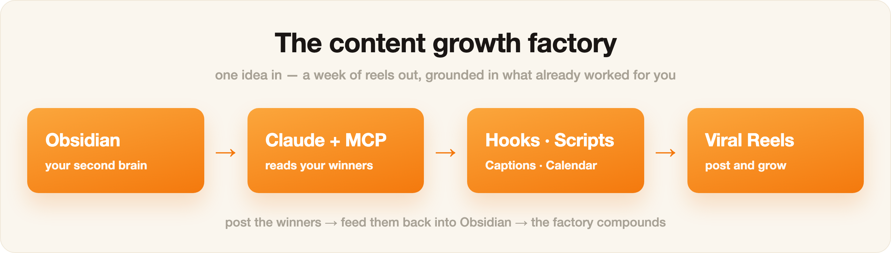

# Claude Instagram Skills

**53 gratis Claude-skills som gjør Claude om til hele Instagram-teamet ditt.** Content research, hooks, manus, reels, karuseller, captions, kommentarsvar og en ferdig innholdskalender. Med Obsidian som Claudes hukommelse, så alt den lager høres ut som deg.

Fra [Implementer KI](https://www.instagram.com/implementer.ai/).

---

## Kom i gang på 2 minutter

Du trenger [Claude Code](https://claude.com/claude-code) (følger med Claude Pro / Max).

**Enklest:** åpne Claude Code og lim inn:

```
Installer skillsene fra https://github.com/joring99/claude-instagram-skills
```

**Eller som plugin** (skriv inn i Claude Code):

```
/plugin marketplace add joring99/claude-instagram-skills
/plugin install claude-instagram-skills@implementer-ki
```

**Eller i terminalen** (macOS / Linux):

```bash
git clone --depth 1 https://github.com/joring99/claude-instagram-skills.git
bash claude-instagram-skills/install.sh
```

Start Claude Code på nytt. Prøv så:

```
/content-research nisjen min er <din nisje>. Svar på norsk.
```

**Har du ikke Claude Code?** Hver skill er en vanlig tekstfil. Åpne `skills/<navn>/SKILL.md`, kopier teksten og lim den inn i [claude.ai](https://claude.ai) sammen med ideen din.

---

## Skillsene du bruker mest

| Skill | Hva den gjør |
|---|---|
| [`/content-factory`](skills/content-factory/SKILL.md) | **Hele løypa i én kommando:** finn format → analyser → hook → manus → reel → caption → kommentarsvar. Start her. |
| [`/content-research`](skills/content-research/SKILL.md) | Finner de mest virale reelsene i nisjen din og bryter ned hook og struktur. |
| [`/reel-analyzer`](skills/reel-analyzer/SKILL.md) | Gi den en viral reel, så får du hook, struktur, tempo og visuelt, beat for beat. |
| [`/viral-hook-writer`](skills/viral-hook-writer/SKILL.md) | 10 hooks fra formler som er bevist at funker, rangert etter hva du bør teste først. |
| [`/reel-scripter`](skills/reel-scripter/SKILL.md) | Et stramt manus på 30 til 45 sekunder i din stemme. |
| [`/reel-builder`](skills/reel-builder/SKILL.md) | Hele reelen: manus, tekst på skjerm, bilde per beat og caption. |
| [`/carousel-builder`](skills/carousel-builder/SKILL.md) | Karuseller, slide for slide. |
| [`/caption-and-hashtags`](skills/caption-and-hashtags/SKILL.md) | Caption, hashtags og første kommentar. |
| [`/comment-responder`](skills/comment-responder/SKILL.md) | Svar på kommentarer og DM-flyt som gjør kommentarer til leads. |
| [`/content-calendar`](skills/content-calendar/SKILL.md) | En ferdig postingplan for to uker. |
| [`/ai-brain`](skills/ai-brain/SKILL.md) | Claudes hukommelse i Obsidian. Si «wrap up», så lagres økten. |

<details>
<summary><b>Alle 53 skills</b></summary>

ab-hook-tester · agent-reach · ai-brain · analytics-readout · audience-personas · b-roll-shot-list · best-time-scheduler · bio-profile-optimizer · campaign-brief · caption-and-hashtags · carousel-builder · collab-outreach · comment-mining · comment-responder · community-engagement-plan · competitor-positioning · competitor-teardown · content-audit · content-calendar · content-factory · content-pillar-builder · content-repurposer · content-research · cover-thumbnail-brief · creator-outreach · cross-platform-distribution · cross-platform-reformatter · cta-writer · dm-script-writer · going-viral · hashtag-keyword-research · hook-mining · influencer-partnerships · launch-retrospective · linkedin-thought-leadership · on-screen-text-writer · paid-social-brief · positioning-audit · profile-conversion-audit · reel-analyzer · reel-builder · reel-scripter · series-planner · social-analytics-report · social-listening · social-proof-mining · story-sequencer · trend-spotter · ugc-creator-brief · utm-campaign-plan · viral-carousel · viral-hook-writer · x-thread-strategy

</details>

Skillsene er skrevet på engelsk, men Claude svarer på norsk. Skriv «svar på norsk» i meldingen, eller legg det inn i `Merkevare/Stemme.md` i Obsidian (se under), så slipper du å si det hver gang.

---

## Anbefalt: Obsidian som Claudes hukommelse

Uten hukommelse starter Claude fra null hver gang, og innholdet blir generisk. Med [Obsidian](https://obsidian.md) (gratis) får Claude en mappe med notater om stemmen din, publikummet ditt og reelsene som har funket. Det er bare vanlige tekstfiler på din egen maskin.



1. Last ned [Obsidian](https://obsidian.md) og installer.
2. Kopier mappen `obsidian-vault/` fra dette repoet til f.eks. `~/Documents/Instagram-hjerne`.
3. I Obsidian: **Open folder as vault** → velg `Instagram-hjerne`.
4. Fyll ut `Merkevare/Stemme.md` og `Merkevare/Publikum.md`, og legg 3 til 5 av dine beste reels i `Vinnere/`.
5. Start Claude Code i den mappen (`cd ~/Documents/Instagram-hjerne && claude`), eller velg mappen som prosjektmappe i Claude-appen.
6. Si «wrap up» på slutten av en økt. Da lagrer [`/ai-brain`](skills/ai-brain/SKILL.md) et notat i `AI Brain/`, og neste gang henter Claude bare det som er relevant.

---

## Lisens og opphav

MIT. Se [LICENSE](LICENSE).

Skillsene er basert på [Ootto-AI/claude-content-skills](https://github.com/Ootto-AI/claude-content-skills) (MIT, © Ootto). `agent-reach` er fra [Panniantong/Agent-Reach](https://github.com/Panniantong/Agent-Reach) (MIT). Norsk README, installasjon og Obsidian-malen er laget av Implementer KI.
